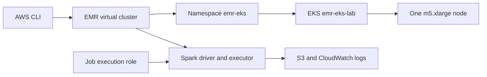

# Learn how to use EMR on EKS for beginners

This beginner-friendly lab creates a one-node Amazon EKS cluster, registers one
Kubernetes namespace as an Amazon EMR virtual cluster, and runs the built-in
Spark Pi example.

## What you will learn

- An **EKS cluster** supplies the Kubernetes control plane and worker capacity.
- A **managed node group** supplies the EC2 instance where Spark pods run.
- A **Kubernetes namespace** isolates the EMR workload.
- An **EMR virtual cluster** is a logical registration of an EKS namespace. It
  does not create another compute cluster.
- A **job execution role** gives Spark pods AWS permissions through EKS OIDC.
- A submitted EMR job creates a Spark driver pod and one executor pod.

## Lab configuration

| Setting | Value |
|---|---|
| AWS profile | `dev` |
| Region | `us-east-1` |
| EKS cluster | `emr-eks-lab` |
| Kubernetes namespace | `emr-eks` |
| EMR virtual cluster | `emr-eks-lab-vc` |
| EKS version | `1.31` |
| Node group | One `m5.xlarge`, min/desired/max all `1` |
| EMR release | `emr-7.10.0-latest` |
| Spark version | `3.5.5-amzn-1` |

There is no Cluster Autoscaler or Karpenter. Capacity is fixed at one node.
The cluster uses two public subnets in the existing default VPC and does not
create a NAT gateway.

## Cost warning

The approximate running cost is the EKS control plane (about `$0.10/hour`),
one `m5.xlarge` (about `$0.19/hour`), and its 20 GiB EBS volume. Pricing can
change. Run the teardown as soon as you finish.

## Architecture



## Prerequisites

The scripts set these values themselves:

```bash
export AWS_PROFILE=dev
export AWS_REGION=us-east-1
```

Verify the profile:

```bash
aws sts get-caller-identity --profile dev
```

Install `eksctl` if it is not already installed:

```bash
brew install eksctl
```

The lab also requires AWS CLI v2 and `kubectl`.

## Step 1: Create EKS

```bash
bash scripts/01-create-cluster.sh
```

This normally takes 15–20 minutes. The script creates the EKS control plane,
one managed node, and an IAM OIDC provider. Inspect the result:

```bash
kubectl get nodes
eksctl get nodegroup --cluster emr-eks-lab --region us-east-1
```

## Step 2: Enable EMR on EKS

```bash
bash scripts/02-enable-emr.sh
```

This step:

1. Creates namespace `emr-eks`.
2. Grants the EMR Containers service namespace-scoped Kubernetes RBAC.
3. Creates the S3 log bucket and CloudWatch log group.
4. Creates `EMRContainers-JobExecutionRole` and scopes its OIDC trust to this
   cluster and namespace.
5. Registers the namespace as virtual cluster `emr-eks-lab-vc`.

Confirm the Kubernetes resources:

```bash
kubectl get namespace emr-eks
kubectl get role,rolebinding -n emr-eks
```

Open the [EMR virtual clusters console](https://us-east-1.console.aws.amazon.com/emr/home?region=us-east-1#/virtual-clusters).
It should now show one running virtual cluster. Select **View details** to see
the mapped EKS cluster and namespace.

## Step 3: Submit Spark Pi

```bash
bash scripts/03-submit-spark-pi.sh
```

The job uses the Python example already included in the EMR image:

```text
local:///usr/lib/spark/examples/src/main/python/pi.py
```

It requests one driver and one executor, each with one core and 2 GiB of
memory. In another terminal, watch Kubernetes while the script runs:

```bash
export AWS_PROFILE=dev AWS_REGION=us-east-1
aws eks update-kubeconfig --name emr-eks-lab
kubectl get pods -n emr-eks -w
```

The submit script polls the EMR job until completion and displays:

- the terminal job state;
- the EMR release label;
- Spark version messages from CloudWatch;
- the `Pi is roughly ...` result;
- the virtual-cluster mapping.

Useful manual commands:

```bash
VC_ID=$(cat .lab/virtual-cluster-id)
JOB_ID=$(cat .lab/job-run-id)

aws emr-containers describe-job-run \
  --virtual-cluster-id "$VC_ID" \
  --id "$JOB_ID"

aws emr-containers list-virtual-clusters \
  --states RUNNING \
  --output table
```

Logs are stored in both:

- CloudWatch log group `/emr-on-eks/lab`
- `s3://emr-on-eks-lab-$ACCOUNT_ID/logs/`

## Finish: avoid further charges

Follow [TEARDOWN.md](TEARDOWN.md). The short version is:

```bash
bash scripts/teardown.sh
```

Do not merely delete the Spark job. EKS and its EC2 node continue billing
until the EKS cluster is deleted.

## References

- [Setting up Amazon EMR on EKS](https://docs.aws.amazon.com/emr/latest/EMR-on-EKS-DevelopmentGuide/setting-up.html)
- [Getting started with Amazon EMR on EKS](https://docs.aws.amazon.com/emr/latest/EMR-on-EKS-DevelopmentGuide/getting-started.html)
- [Amazon EMR 7.10.0 release](https://docs.aws.amazon.com/emr/latest/ReleaseGuide/emr-7100-release.html)
- [EMR on EKS walkthrough](https://medium.com/@vinodsharmamui/emr-cluster-setup-on-eks-a11dd0b6cb2a)
